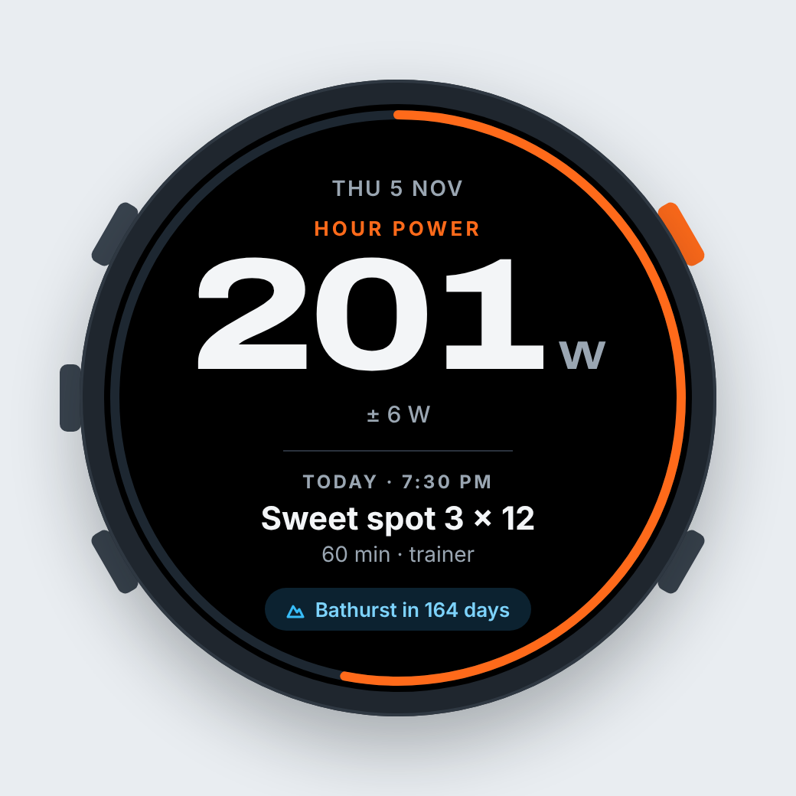
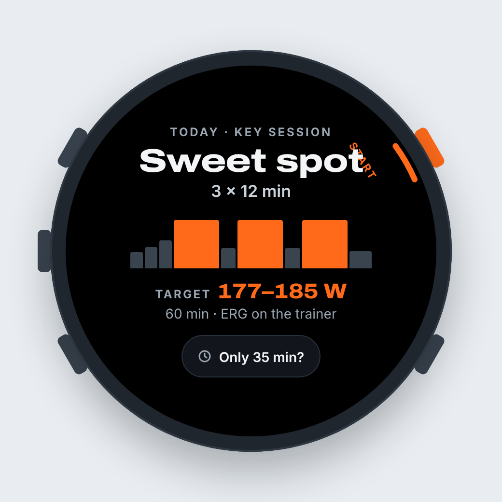
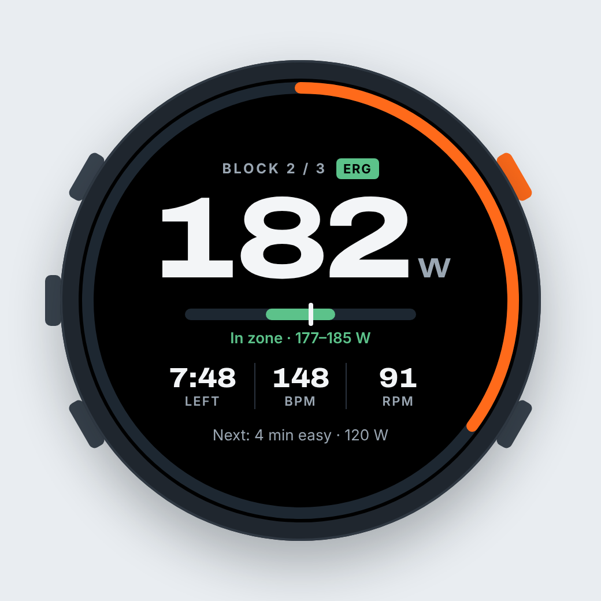
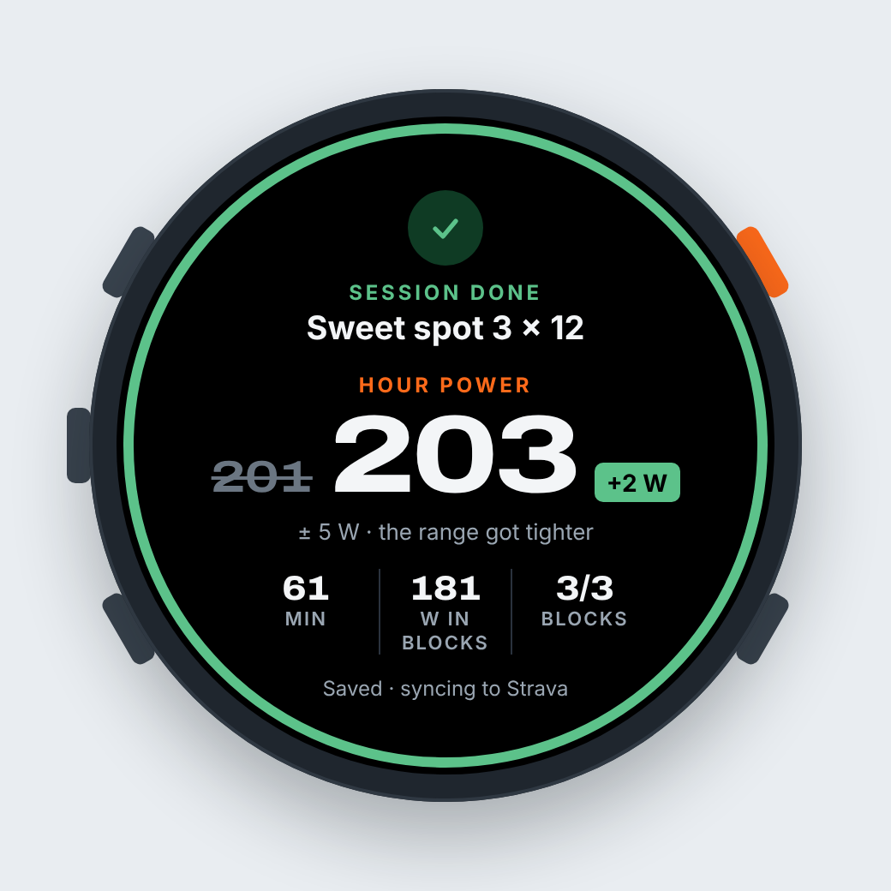
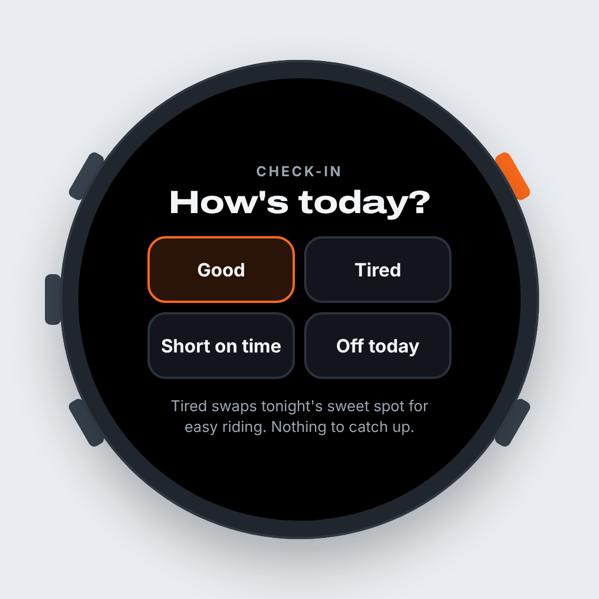
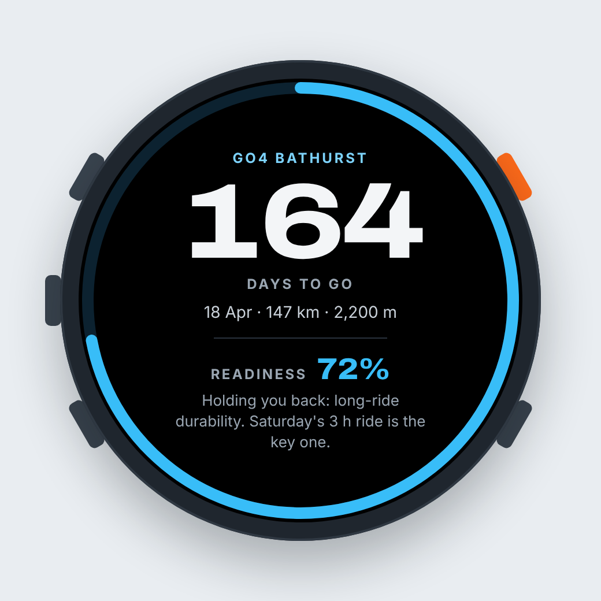

# Hour Power Lite: Garmin watch app mock-up

Design mock-up for the **Connect IQ watch app (lite)** roadmap item in `docs/product-strategy.md`, pulled from the
"Hour Power Watch Lite" design canvas (https://claude.ai/artifact/T9ZrC6DnMFYGWmth9F8QdK) on 5 November 2026.
Numbers are illustrative.

Lite scope: glance → session → ride → result. Check-in and goal are swipe-up pages from the glance.
Start (top-right button) begins or laps; Back (bottom-right) pauses or leaves.

| # | Screen | Source | Preview |
|---|--------|--------|---------|
| 1 | Today glance: hour power, week ring, today's session, Bathurst countdown | `Main.dc.html` |  |
| 2 | Today's session: shape, target watts, "Only 35 min?" | `Workout.dc.html` |  |
| 3 | Riding the interval: ERG watts, zone bar, time left, HR, cadence | `Ride.dc.html` |  |
| 4 | Ride done: new hour power and range | `Summary.dc.html` |  |
| 5 | Morning check-in: Good / Tired / Short on time / Off today | `Checkin.dc.html` |  |
| 6 | Bathurst countdown and readiness | `Goal.dc.html` |  |

Palette: black face, text `#f3f5f7`, muted `#9aa6b2`, accent orange `#ff6a1a`, in-zone green `#5cc28a`, goal blue `#38bdf8`.
Type: Archivo (wide, 800) for numbers, Inter for labels. Screen is a 384 px round face.

The `.dc.html` files are the canvas sources (they need the canvas runtime to render live); `canvas.json` is the layout.
The PNGs are static renders at 2×, accent set to orange.
